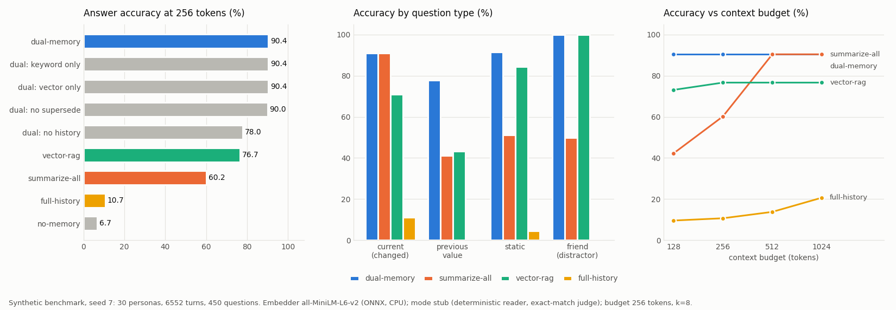

# dual-memory

[](https://github.com/VinVirtual/dual-memory/actions/workflows/test.yml) [](LICENSE)

Memory for AI agents in two parts: a **working memory** of recent turns that stays inside a token budget, and a **long-term memory** of facts and episodes in one SQLite file, found again by vector, keyword, recency and importance together. When a fact changes, the new one supersedes the old one, and both are kept with their dates and sources.

It comes with a **reproducible benchmark** on synthetic multi-session conversations, run against four baselines. Every number below was produced by the commands in this README on one machine, without an API key.



## What it does

- **Working memory**: turns are kept until they pass `working_tokens`; then the oldest are summarised into a short running summary and handed to long-term memory. The newest turn is never dropped.
- **Long-term memory**: facts (`subject`, `attribute`, `value`) and session episodes, each with an embedding, importance, timestamps, a mention count and provenance (session, turn, source text). Stored in SQLite with an FTS5 index.
- **Hybrid retrieval**: cosine similarity + BM25 + recency decay + importance, with the weights exposed and every score part returned.
- **Dedupe and contradictions**: the same fact again reinforces the old row. A new value for a one-value-at-a-time fact (city, job, diet...) supersedes the old row, linked both ways, with the time of the change. A late-arriving older statement never overrides a newer one. `history()` returns every value a fact has had.
- **Prompt context**: `context()` writes a dated text block, and earlier values come along marked "no longer true since ...", so a model can answer "where did they live before?".
- **Pluggable parts**: embedder (hashing fallback, or MiniLM via onnxruntime on the CPU), LLM (any OpenAI-compatible endpoint, or a deterministic stub), extractor, summariser, token counter, clock.

## Quick start

```bash
git clone https://github.com/VinVirtual/dual-memory && cd dual-memory
python -m venv .venv && . .venv/bin/activate
pip install -e .            # numpy only; add ".[onnx]" for MiniLM, ".[bench]" for the chart, ".[dev]" for tests
./check_env.sh
```

```python
from dual_memory import DualMemory, RuleAnswerer

day = 86400.0
mem = DualMemory("quickstart.sqlite", user_name="Mira")  # HashingEmbedder + rule extractor by default

mem.add("user", "Hi! I live in Porto and I work as a nurse.", ts=1_736_000_000)
mem.add("assistant", "Nice to meet you, Mira!", ts=1_736_000_030)
mem.end_session()  # facts go to long-term memory, the session becomes an episode

mem.add("user", "Big news: I just moved to Lisbon!", ts=1_736_000_000 + 30 * day)
mem.end_session()  # "Lisbon" supersedes "Porto"; both are kept, linked, with dates

for hit in mem.recall("Where does Mira live?", k=3):
    print(f"{hit.score:.2f}  {hit.item.status:<10} {hit.item.text}")  # score includes recency

context = mem.context("Where does Mira live?")  # dated text block for your prompt
print(context)
reader = RuleAnswerer()  # deterministic stand-in for an LLM
print(reader.answer("Where does Mira live now?", context))  # Lisbon
print(reader.answer("Where did Mira live before?", context))  # Porto
mem.close()
```

This is [`examples/quickstart.py`](examples/quickstart.py). It prints:

```text
0.46  active     Mira lives in Lisbon.
0.27  active     [2025-01-04] Mira: I live in Porto and I work as a nurse.
0.24  active     Mira works as a nurse.
[2025-01-04] Mira lives in Porto. (no longer true since 2025-02-03)
[2025-02-03] Mira lives in Lisbon.
[2025-01-04] Mira: I live in Porto and I work as a nurse.
[2025-01-04] Mira works as a nurse.
[2025-02-03] Mira: Big news: I just moved to Lisbon!
Lisbon
Porto
```

With a real model and real embeddings:

```python
from dual_memory import DualMemory, OnnxEmbedder, OpenAICompatibleLLM

llm = OpenAICompatibleLLM("your-model", base_url="http://localhost:8000/v1", api_key_env="MY_LLM_KEY")
mem = DualMemory("mira.sqlite", user_name="Mira", embedder=OnnxEmbedder(), llm=llm)
messages = mem.messages("What should I cook tonight?") + [{"role": "user", "content": "What should I cook tonight?"}]
```

The key is read from the environment variable you name, at call time. It is never written anywhere.

## How it works

1. **Add**: each turn goes into working memory with its time, session and index.
2. **Overflow or end of session**: the oldest turns are summarised (rule-based extractive summary, or the LLM) and passed to the extractor, which turns them into facts.
3. **Remember**: each fact is reinforced, superseded or inserted (rules in [docs/api.md](docs/api.md)). At the end of a session, a short episode summary is stored too.
4. **Recall**: 50 candidates by cosine and 50 by BM25 are merged and scored; the top `k` are returned with their score parts.
5. **Context**: the top memories, plus earlier values of each fact, are written as dated lines within a token budget.

## The benchmark

Synthetic conversations, generated by a seeded script: **30 fictional personas, 12 sessions each over four to six months, 6,552 turns and 450 questions**. Facts change over time, friends' facts act as distractors, there are negated and hypothetical statements, and each of a persona's own fact statements has a 15% chance of using wording the rule extractor does not know (60 of 485 in the default dataset). Questions ask for the current value of a changed fact, the value *before* it, facts that never changed, a friend's fact, and things never mentioned (the right answer is "unknown").

Each method must fit what it remembers into the same **256-token context**. A deterministic reader then answers from that context and answers are scored by exact match. **This stub mode needs no API key, and it measures whether the right, dated fact reached the context, not how well a model reasons.** What every mode and metric means is in [docs/benchmark.md](docs/benchmark.md).

Results with the MiniLM embedder (`all-MiniLM-L6-v2`, ONNX on the CPU), from [`examples/benchmark/minilm/results.md`](examples/benchmark/minilm/results.md):

| method | accuracy % | current | previous | static | friend | abstain | stale % | answer in context % | recall@8 % | retrieve p50 ms | storage KB |
|---|---|---|---|---|---|---|---|---|---|---|---|
| no-memory | 6.7 | 0.0 | 0.0 | 0.0 | 0.0 | 100.0 | 0.0 | 0.0 | n/a | 0.001 | 0 |
| full-history (last 256 tokens) | 10.7 | 11.1 | 0.0 | 4.4 | 0.0 | 100.0 | 0.0 | 6.7 | n/a | 0.122 | 410 |
| vector-rag (top 8 turns) | 76.7 | 71.1 | 43.3 | 84.4 | 100.0 | 100.0 | 16.7 | 86.4 | 86.4 | 4.907 | 15132 |
| summarize-all | 60.2 | 91.1 | 41.1 | 51.1 | 50.0 | 100.0 | 6.7 | 60.0 | n/a | 0.066 | 21 |
| **dual-memory** | **90.4** | 91.1 | 77.8 | 91.7 | 100.0 | 100.0 | 7.8 | 91.9 | 82.1 | 8.798 | 3296 |
| dual: no supersede | 90.0 | 90.0 | 76.7 | 91.7 | 100.0 | 100.0 | 8.9 | 91.9 | 92.1 | 8.45 | 3296 |
| dual: vector only | 90.4 | 91.1 | 77.8 | 91.7 | 100.0 | 100.0 | 7.8 | 93.1 | 82.9 | 8.534 | 3296 |
| dual: keyword only | 90.4 | 91.1 | 77.8 | 91.7 | 100.0 | 100.0 | 7.8 | 91.4 | 89.3 | 8.663 | 3296 |
| dual: no history | 78.0 | 91.1 | 15.6 | 91.7 | 100.0 | 100.0 | 7.8 | 80.0 | 82.1 | 8.68 | 3296 |

What the numbers say, and what they do not:

- **dual-memory answered 90.4% of questions** against 76.7% for plain vector RAG over all turns and 60.2% for one running summary. On the 408 questions whose gold statement used known wording it answered 98.3%. Every one of its misses involves a statement of that same fact in wording the rule extractor skips (for the 7 misses among the 408, a later change was paraphrased, so the reader took the old value for the current one).
- **"Before" questions are where the methods differ most**: 77.8% for dual-memory, 43.3% for vector RAG, 41.1% for the summary. Without the earlier values in the context (`dual: no history`) dual-memory falls to 15.6%.
- **Superseding keeps the store consistent**: for 91.1% of the facts that changed, exactly one active value remains and it is the latest; with superseding off, 10.0%. Stub accuracy hardly moves (90.0%), because the deterministic reader always picks the newest dated line. A real model reading two conflicting lines is not that disciplined; that part is not measured here.
- **The summary catches up when the budget is large enough.** At 512 and 1,024 tokens, summarize-all also reaches 90.4%: each persona's facts then fit in the summary. At 128 tokens it drops to 42.2% while dual-memory stays at 90.4%. Full history cut to the budget stays near 10-20% at every budget.
- **Hybrid retrieval rescues a weak embedder.** With the hashing embedder (no model) the same run gives 90.4% for dual-memory but 74.9% for its vector-only variant and 49.8% for vector RAG ([`examples/benchmark/hashing/results.md`](examples/benchmark/hashing/results.md)). With MiniLM, vector-only and keyword-only rankings each reach 90.4% on this data.
- Storage is summed over the 30 personas: vector RAG keeps an embedding for every turn (15.1 MB), dual-memory keeps facts and episodes (3.3 MB). Latency is per question on a shared 16-core laptop CPU (AMD Ryzen 7 255) with other jobs running; MiniLM query embedding dominates it.

Reproduce:

```bash
pip install -e ".[onnx,bench]"
dual-memory generate --out data.json
dual-memory bench --data data.json --out results --embedder onnx --budgets 128,256,512,1024
```

## Commands

```bash
dual-memory generate --out data.json [--seed 7 --personas 30 --sessions 12 --friends 4 --paraphrase-rate 0.15]
dual-memory bench --data data.json --out results [--embedder hashing|onnx] [--budget 256] [--budgets 128,256,512,1024] [--k 8]
                  [--methods no-memory,full-history,vector-rag,summarize-all,dual-memory,...]
                  [--llm-model NAME --llm-base-url URL --llm-key-env VAR]
dual-memory chart results            # redraw chart.png from a results folder
dual-memory check                    # Python, SQLite FTS5, optional extras
```

## Limits

- **The rule extractor knows a fixed list of English phrasings** ([docs/extraction.md](docs/extraction.md)) and skips any negated or hypothetical sentence. Use an LLM extractor for real conversations.
- **Facts are slots** (subject, attribute, value). Relations between facts, events with durations and multi-hop reasoning are not modelled; episodes hold the rest as text.
- **Vector search is exact** (a NumPy product over a user's active memories). It is fast for tens of thousands of memories per user, not millions; there is no ANN index.
- **One SQLite file per user or agent**, one writer at a time. There is no access control inside a file; keep files per tenant.
- `forget()` deletes the row and SQLite's `secure_delete` overwrites its bytes, but copies can remain in the write-ahead log until a checkpoint, in backups, and in text you already sent to a model.
- Token counts are estimated (`approx_tokens`) unless you pass a real tokenizer as `counter`.
- The benchmark is synthetic and its numbers come from a deterministic reader; see the limits in [docs/benchmark.md](docs/benchmark.md). LLM mode is implemented and tested against a local fake server, but no LLM-mode results were run or are reported.
- Tested on Linux with Python 3.10 (and 3.12 in CI).

## Development

```bash
pip install -e ".[dev]"
pytest --cov=dual_memory        # 212 tests; the ONNX test is skipped when the model is not downloaded
ruff check src tests && mypy
```

Third-party assets and their licences are listed in [ASSETS.md](ASSETS.md).

## Licence

MIT, see [LICENSE](LICENSE).
